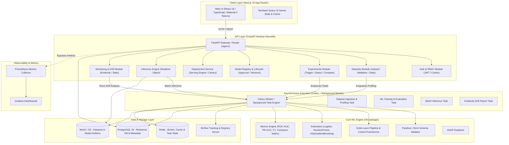

# ModelOps Studio — System Architecture & Design

## 1. Executive Summary

ModelOps Studio is a production-oriented, full-stack Machine Learning Model-to-Production platform. The platform manages the entire lifecycle of tabular machine learning models: from dataset ingestion, validation, exploratory analysis, reproducible training, MLflow experiment tracking, model registry and approval, through to real-time & batch inference, data drift detection, and automated monitoring.

## 2. High-Level Architecture Diagram

## 3. Component Breakdown

### 3.1 Frontend (`apps/web`)
- **Framework**: Next.js (App Router), React, TypeScript (strict mode).
- **Design System**: Google Material 3 design tokens implemented using Tailwind CSS and Radix UI primitives.
- **State Management**: TanStack Query v5 for server state caching, optimistic updates, and background refetching.
- **Forms & Validation**: React Hook Form with Zod schemas matching backend Pydantic contracts.
- **Visualizations**: Recharts for latency histograms, ROC/PR curves, confusion matrices, and drift distributions.

### 3.2 Backend Modular Monolith (`apps/api`)
- **Framework**: FastAPI with Pydantic v2 and `pydantic-settings`.
- **Database Engine**: SQLAlchemy 2.0 (asyncio) with Alembic migrations.
- **Domain Modules**:
  - `auth`: JWT token generation, password hashing (Argon2id/Bcrypt), workspace context injection.
  - `workspaces`: Multi-tenant workspace data isolation.
  - `datasets`: Streaming CSV ingestion, Pandera schema validation, column-level profiling.
  - `experiments`: Hyperparameter validation, run triggering, MLflow synchronization.
  - `models`: Model versioning, stage transitions (`draft` -> `evaluated` -> `approved` -> `deployed` -> `archived`).
  - `deployments`: Active deployment manager, traffic routing, rollbacks.
  - `predictions`: Low-latency real-time inference endpoint and asynchronous batch inference.
  - `monitoring`: Drift calculation jobs, prediction latency/throughput metrics, alerts.

### 3.3 ML Engine (`ml/`)
- **Self-Contained Pipeline**: Standalone package that can be invoked via CLI, imported by the worker, or executed in testing.
- **Zero Training/Serving Skew**:
  - `ColumnTransformer` handles numerical scaling, categorical imputation, and one-hot encoding.
  - Serialized as a single `Pipeline(steps=[('preprocessor', preprocessor), ('classifier', model)])` saved via `joblib`.
  - Inference requests pass raw JSON features into `pipeline.predict_proba(df)` with identical transformations guaranteed.

### 3.4 Storage & Task Execution Layer
- **Relational DB**: PostgreSQL 18 stores user accounts, workspace memberships, dataset metadata, experiment metrics, model registry records, deployments, predictions, and audit logs.
- **Object Storage**: MinIO (S3 compatible) stores raw uploaded CSVs and serialized model `.joblib` artifacts.
- **Broker & Queue**: Celery with Redis broker for asynchronous compute-intensive tasks, with an automatic in-process fallback engine for standalone developer machines without Redis running.

## 4. Security Architecture
1. **Tenant Isolation**: Every database entity has a `workspace_id`. Repositories filter on `workspace_id` automatically via dependency injection.
2. **Untrusted Input Sanitization**:
   - Max file size limits on CSV uploads (default 50MB).
   - Strict Pandera and Pydantic validation before any data touches ML pipelines.
   - SQL injection prevention via parameterized SQLAlchemy queries.
   - Filenames sanitized to prevent directory traversal (`secure_filename`).
3. **Secrets Management**: No secrets committed; loaded strictly via environment variables.
